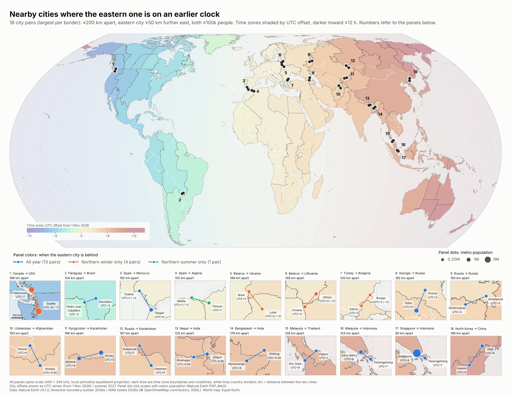

# time-zone-inversions

Mapping nearby city pairs where time zone differences are in the "wrong" direction: the more easterly city keeps the earlier clock.

From 1 November 2026, British Columbia stays on UTC−7 while Washington State falls back to UTC−8, so Seattle is an hour behind Vancouver even though it lies about 60 km further east. This project finds every similar pair of nearby cities worldwide and maps them.



The published page is in [`docs/`](docs/) and is served with GitHub Pages.

## Selection criteria

The thresholds are anchored on Seattle–Vancouver:

- **Distance:** both cities within 200 km of each other, measured on the WGS84 ellipsoid (Seattle–Vancouver: 196 km).
- **East–west offset:** the eastern city is at least 50 km further east (Seattle: 60 km).
- **Inverted clock:** the eastern city's UTC offset is behind the western city's, in northern winter (from 1 Nov 2026), northern summer (July 2027), or both.
- **Population:** both cities have a metro population (Natural Earth `POP_MAX`) of at least 100,000.
- **One per border:** for each pair of countries, only the pair with the largest smaller city is kept. This leaves 18 pairs.

## Reproducing

Requires Python 3.11+ and GDAL-compatible wheels (installed automatically by pip).

```sh
python3 -m venv .venv
.venv/bin/pip install -r requirements.txt
scripts/build.sh
```

`scripts/build.sh` downloads the source data into `data/raw/` if it's missing (about 490 MB), then runs these steps:

| Step | Script | Output |
|---|---|---|
| Find nearby pairs and inverted pairs | `analysis/inverted_pairs.py 100000 200` | `output/city_pairs_*.csv`, `output/cities_*.csv` |
| Apply the 50 km east–west filter and keep one pair per border | `analysis/map_world.py --one-per-border` | `output/inverted_pairs_*_ew50*.csv` |
| Draw the map | `analysis/map_with_insets.py` | `output/map_inverted_pairs_with_panels.png` / `.svg` |
| Build the web page | `analysis/make_page.py` | `docs/index.html` |

`inverted_pairs.py` takes the population and distance thresholds as arguments, so you can explore other cut-offs.

## Data sources

- **Countries and populated places:** [Natural Earth](https://www.naturalearthdata.com/) v5.1.2 (public domain), from the [natural-earth-vector](https://github.com/nvkelso/natural-earth-vector) repository.
- **Time zone boundaries:** [timezone-boundary-builder](https://github.com/evansiroky/timezone-boundary-builder) release 2026e, © [OpenStreetMap contributors](https://www.openstreetmap.org/copyright), under the [Open Database License (ODbL)](https://opendatacommons.org/licenses/odbl/).
- **UTC offsets:** [IANA time zone database](https://www.iana.org/time-zones) 2026e, via the Python `tzdata` package. This release includes 2026's permanent-time changes in British Columbia, Alberta, the Northwest Territories and Manitoba.

The raw data isn't committed. `scripts/download_data.sh` fetches it at pinned versions.

## Caveats

- Natural Earth's populated places are selected for cartography, not as a complete census, so some qualifying pairs may be missing.
- Time zones follow the IANA database and OpenStreetMap, which may differ from local practice in disputed or occupied areas.

## License

Code is under the MIT License (see [LICENSE](LICENSE)). The map and derived data include OpenStreetMap-derived time zone boundaries and must carry the ODbL attribution above.
